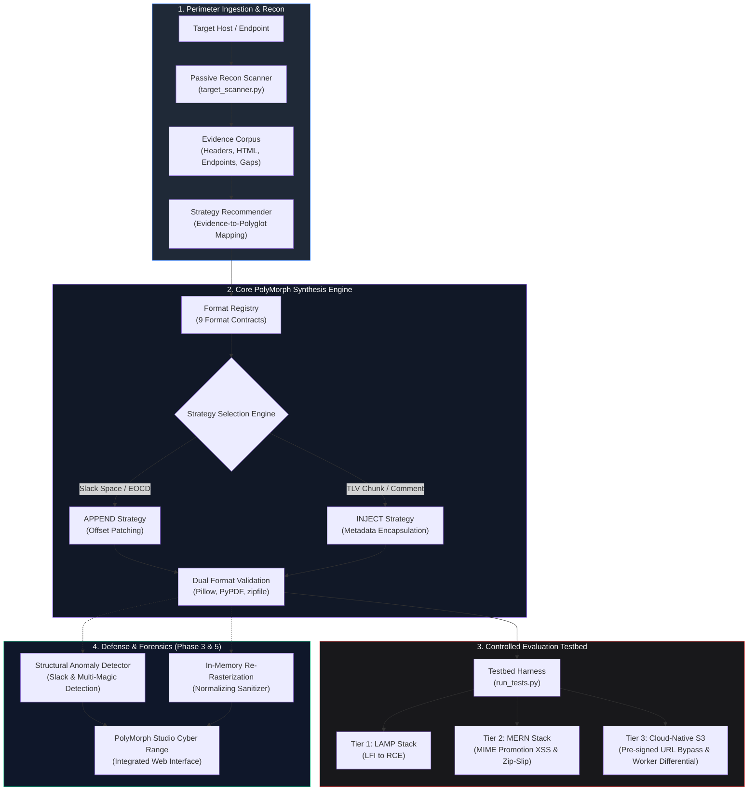
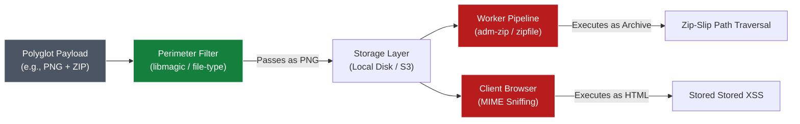
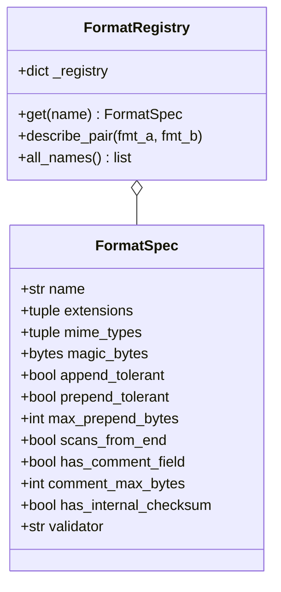
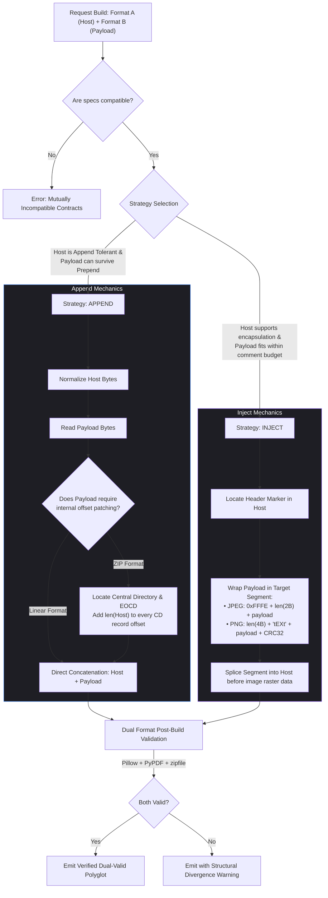
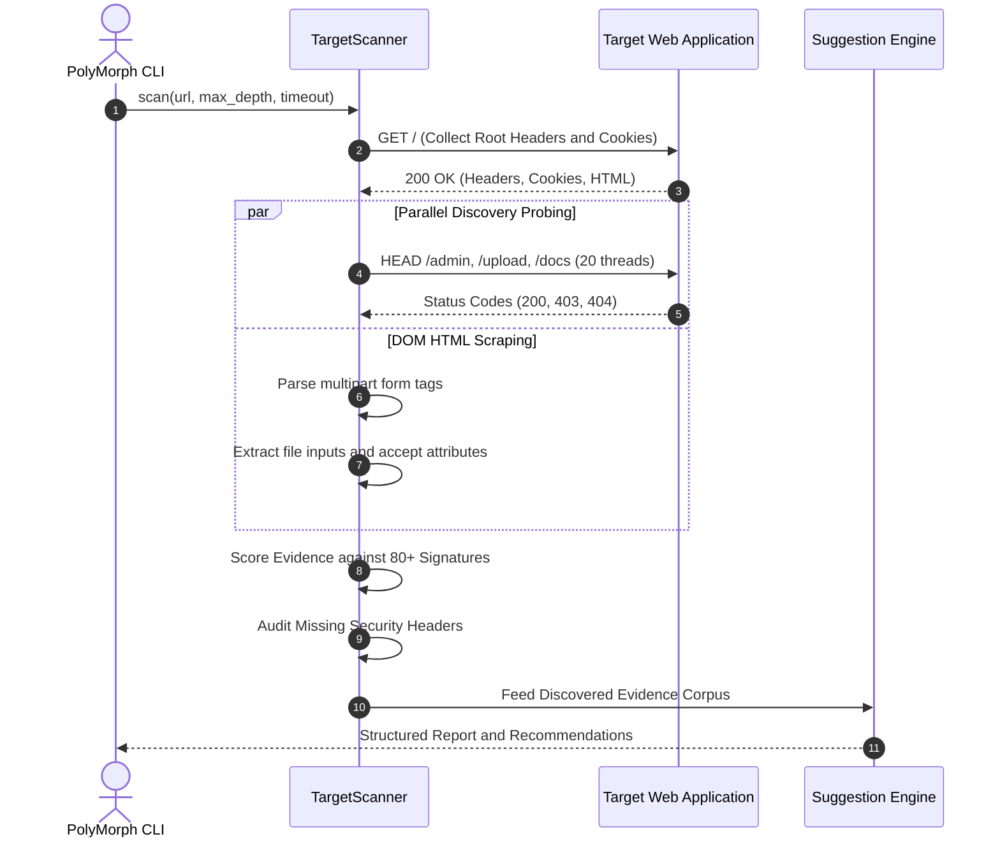
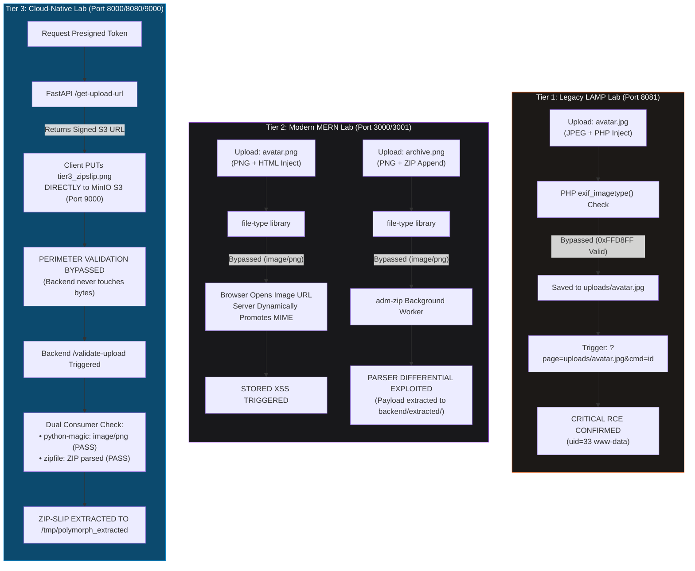

# PolyMorph: Format Behavior Analysis, Polyglot Synthesis & Security Evaluation Framework
## Comprehensive Project Guide & Research Roadmap

**Institution:** School of Cyber Security & Digital Forensics, National Forensic Sciences University (NFSU), Gandhinagar  
**Academic Context:** Master's Capstone Defense & Technical Guide  
<!-- **Project Repository:** `d:\Sem Docs\sem 7 docs\Project\PolyMorph` -->

---

## Executive Summary & System Overview

PolyMorph is an offensive and defensive security framework designed to study, synthesize, evaluate, and mitigate **file format parsing differentials** and **polyglot files**. Modern cloud, web, and enterprise architectures process files across heterogeneous components (perimeter WAFs, content filters, backend microservices, background asynchronous workers, and client browsers). 

Because each layer uses independent, divergent parsing implementations, a single byte stream can be simultaneously validated as benign media by a perimeter guard, executed as server-side code by a runtime, unpacked as an archive by an asynchronous worker, and interpreted as script by a browser.

---

## 1. Introduction (I)

### 1.1 Genesis & The Core Idea
File upload mechanisms are traditionally evaluated on perimeter heuristics:
1. **File Extension Verification** (e.g., checking if `.png` is at the end of a string).
2. **Magic Byte Sniffing** (e.g., inspecting if the first 4 bytes match `\x89PNG` or `\xFF\xD8\xFF`).

These heuristics rest on a fundamentally flawed premise: **that a file belongs to exactly one format**. 

In computing theory, file format specifications (RFCs, ISO, Adobe, PKWARE standards) are written independently. Some formats read sequentially from byte 0 (JPEG, PNG). Others read from the end of the file backward (ZIP Central Directory). Others permit arbitrary binary padding before delimiters (PDF, HTML). 

A **polyglot file** is a valid sequence of bytes that satisfies the structural syntax of two or more distinct file format specifications simultaneously without corruption.

### 1.2 The Problem Statement
In distributed software stacks, a file is never processed by a single entity. It passes through an **Asymmetric Parsing Pipeline**:

When Parser A and Parser B disagree on the semantic boundary, internal structure, or true type of a file, a **Parser Differential** vulnerability exists. This leads to:
* **Perimeter Bypass:** Dangerous files (webshells, archives, HTML scripts) disguise themselves under trusted image signatures.
* **Remote Code Execution (RCE):** Server-side inclusion (LFI) of image-wrapped code.
* **Zip-Slip / Path Traversal:** Background extractors unzipping payloads masquerading as pictures.
* **Stored Client-Side Execution (XSS):** Browsers MIME-sniffing scripts from unsanitized image endpoints.

### 1.3 Research Objectives
1. **Formalize Parsing Contracts:** Measure and document the exact byte tolerance (prepend tolerance, append tolerance, comment field limits) of major binary formats.
2. **Automated Synthesis:** Construct valid polyglots programmatically using automated offset calculation, checksum preservation, and table re-indexing.
3. **Target-Agnostic Reconnaissance:** Passively inspect target systems to discover exposed endpoints, missing security headers, and recommend viable polyglot vectors.
4. **Empirical Evaluation:** Test synthesized artifacts against real-world, multi-tier vulnerable testbeds (Legacy LAMP, Modern MERN, Cloud-Native FastAPI/S3).
5. **Defensive Formalization:** Engineer structural detectors and sanitizers that neutralize polyglots without breaking valid user files.

---

## 2. Methods & Architectural Approach (M)

### 2.1 Format Contract Specification
PolyMorph defines a rigorous contract (`FormatSpec`) for every supported format across 13 dimensional attributes:

| Format | Extensions | Magic Bytes | Append Tolerant? | Prepend Tolerant? | Max Prepend | Scans From | Primary Injection Carrier |
|:---:|:---:|:---:|:---:|:---:|:---:|:---:|:---|
| **JPEG** | `.jpg`, `.jpeg` | `FF D8 FF` | Yes (EOF Slack) | No | 0 B | Start | `COM` (`0xFFFE`) Marker |
| **PNG** | `.png` | `89 50 4E 47` | Yes (post-`IEND`) | No | 0 B | Start | Ancillary Chunk (`tEXt`, `zTXt`) |
| **GIF** | `.gif` | `47 49 46 38` | Yes (post-`0x3B`) | No | 0 B | Start | Comment Extension Block |
| **PDF** | `.pdf` | `25 50 44 46` | Yes (post-`%%EOF`) | Yes (Standard lax) | Up to 1024 B | End/Start | PDF Stream / Metadata / Comment |
| **ZIP** | `.zip`, `.jar` | `50 4B 03 04` | Yes (EOCD comment)| Yes (Self-Extract) | Unlimited | **End (EOCD)** | Central Directory Padding |
| **HTML** | `.html`, `.htm` | None (Contextual)| Yes | Yes | Unlimited | Start | Any markup comment or script |
| **PHP** | `.php` | None (`<?php`) | Yes | Yes | Unlimited | Linear Search | Native token parser |

### 2.2 Synthesis Mechanics (The Two Core Strategies)

#### Strategy 1: `APPEND` (Dual-Parser Divergence)
Used primarily when Format A scans from byte 0 and ignores trailing data after an End-of-File marker, while Format B scans backward from the end of the file.
* **The Prime Pair:** `PNG + ZIP` or `JPEG + ZIP`.
* **The Engineering Challenge:** A raw ZIP file stores internal 32-bit absolute offsets pointing to each file's Local File Header. If a 200-byte PNG is placed in front of a ZIP, all internal ZIP pointers will be misaligned by exactly 200 bytes, causing standard archivers to report archive corruption.
* **PolyMorph Innovation:** `zip_fmt.patch_offsets_and_tail()` traverses the Central Directory in memory, increments each `relative_offset_of_local_header` by `len(Host_Bytes)`, and recalculates the End of Central Directory (EOCD) record lengths before concatenation.

#### Strategy 2: `INJECT` (Metadata Encapsulation)
Used when Format B (e.g. PHP script, HTML/JS payload) must execute through an interpreter while disguised inside a strictly validated container (JPEG, PNG).
* **JPEG Injection:** Inserts payload into an application or comment marker (`0xFFFE`). JPEG decoders read the marker length, skip over the payload, and render the image pixels without defect.
* **PNG Injection:** Inserts payload into a newly minted ancillary chunk (`tEXtComment\0`). The 4-byte CRC32 is dynamically computed over the chunk type and payload so strict decoders do not reject the chunk.

---

### 2.3 Passive Reconnaissance Engine (`TargetScanner`)
The reconnaissance module operates on an evidence-based inference model with **zero hardcoded assumptions** about the target technology stack.

---

## 3. Results & Empirical Validation (R)

The framework was evaluated using the automated testing harness (`testbed/harness/run_tests.py`) across three isolated, intentionally vulnerable target architectures.

### 3.1 Empirical Exploitation Matrix (100% Real Lab Data)
The automated harness produced the following verification record:

| Testbed Tier | Technology Stack | Attack Vector Tested | Mechanics | Verification Result | Impact |
|:---:|:---|:---|:---|:---:|:---:|
| **Tier 1** | Apache 2.4 + PHP 8.1 | JPEG+PHP Injection | Header valid `exif_imagetype()`, PHP engine executes embedded `<?php` tag | **BYPASS (Confirmed)** | **RCE** (`uid=33(www-data)`) |
| **Tier 2** | Node.js 18 + Express | PNG+HTML Injection | `file-type` checks magic; missing nosniff promotes to HTML | **BYPASS (Confirmed)** | **Stored XSS** |
| **Tier 2** | Node.js 18 + Express | PNG+ZIP Differential | Image filter passes; `adm-zip` background worker extracts archive payload | **BYPASS (Confirmed)** | **Parser Differential / Zip-Slip** |
| **Tier 3** | FastAPI + MinIO S3 | Pre-signed URL Bypass | Client requests signed URL; uploads direct to S3 bypassing FastAPI middleware | **BYPASS (Confirmed)** | **Perimeter Bypass** |
| **Tier 3** | FastAPI + MinIO S3 | Parser Differential | `python-magic` returns `image/png`; `zipfile.ZipFile` extracts `pwned_tier2.txt` | **BYPASS (Confirmed)** | **Cloud Worker Compromise** |

*Verified harness log:* `Total Tests: 5 | Bypassed: 5 | Blocked: 0 | Execution Time: 4.8s`

---

## 4. Discussion: Honest Limitations, Drawbacks & Future Work (D)

To maintain strict academic integrity, the fundamental boundaries and failure modes of polyglot synthesis must be explicitly stated.

### 4.1 Fundamental Limits & Drawbacks
1. **The Mutual Prepend Constraint (Hard Boundary):**
   * Two formats that *both* require their magic bytes to reside strictly at byte index 0 (offset 0) **cannot** be combined via append or prepend.
   * *Example:* A pure JPEG (`0xFFD8`) and a pure PNG (`0x89504E47`) cannot be merged by linear concatenation. One cannot prepend the other without corrupting the host's magic header.
2. **Defeat via Re-Rasterization (Sanitization Vulnerability):**
   * If a target server processes an uploaded image using an active image processing library that **decodes the bitmap to raw pixel memory and re-encodes it** (e.g., using `PIL.Image.open(f).save(out)`), **all injected comments, metadata chunks, and EOF slack space are stripped completely**.
   * PolyMorph polyglots survive storage, caching, and transmission, but do *not* survive active re-compression/normalization pipelines.
3. **MIME Sniffing Browser Dependencies:**
   * PNG+HTML polyglots depend on either:
     a) The server omitting `X-Content-Type-Options: nosniff`.
     b) The server misclassifying the content type.
   * If a modern browser receives `Content-Type: image/png` alongside `X-Content-Type-Options: nosniff`, it strictly invokes its native image decoding engine and will **never** execute the embedded JavaScript.
4. **Length and Chunk Budget Limits:**
   * JPEG `COM` markers have an absolute 16-bit payload length limit ($2^{16} - 1 = 65,535\text{ bytes}$). Payloads exceeding 64 KB cannot be injected into a single JPEG comment segment.

---

### 4.2 Comprehensive Project Roadmap

```mermaid
flowchart TD
    subgraph PHASE1["PHASE 1: Core Synthesis Engine (COMPLETE ✅)"]
        P1_1["Format Registry (9 Formats)"]
        P1_2["Append & Inject Synthesis Engines"]
        P1_3["Structural Validators (Pillow, PyPDF, zipfile)"]
        P1_4["Rich CLI (build, info, formats, probe)"]
    end

    subgraph PHASE2["PHASE 2: Vulnerable Testbeds & Harness (COMPLETE ✅)"]
        P2_1["Tier 1: Legacy LAMP Lab"]
        P2_2["Tier 2: Modern MERN Lab"]
        P2_3["Tier 3: Cloud-Native S3 / FastAPI Lab"]
        P2_4["Automated Evaluation Harness (run_tests.py)"]
    end

    subgraph PHASE4["PHASE 4: General-Purpose Recon (COMPLETE ✅)"]
        P4_1["Passive Web Scanner (target_scanner.py)"]
        P4_2["80+ Tech Evidence Signatures"]
        P4_3["Security Header & Gap Audit"]
        P4_4["Automated Strategy Suggestion Engine"]
    end

    subgraph PHASE3["PHASE 3: Defensive Engine (NEXT IMMEDIATE STEP ⏳)"]
        P3_1["Structural Anomaly Detector<br/>(Slack space & multi-magic detector)"]
        P3_2["Normalizing Sanitizer<br/>(In-memory re-rasterization engine)"]
        P3_3["Dual-Consumer Discrepancy Analyzer"]
    end

    subgraph PHASE5["PHASE 5: PolyMorph Studio Cyber Range (FINAL STAGE 🎯)"]
        P5_1["Unified Cyber Range Web UI<br/>(FastAPI Backend + React Frontend)"]
        P5_2["Tab 1: Target Recon & Polyglot Crafter"]
        P5_3["Tab 2: Simulation Cyber Range & Live Firing"]
        P5_4["Tab 3: Forensics & Defense Sandbox"]
    end

    PHASE1 --> PHASE2
    PHASE2 --> PHASE4
    PHASE4 --> PHASE3
    PHASE3 --> PHASE5

    style PHASE1 fill:#14532d,stroke:#22c55e,color:#fff
    style PHASE2 fill:#14532d,stroke:#22c55e,color:#fff
    style PHASE4 fill:#14532d,stroke:#22c55e,color:#fff
    style PHASE3 fill:#713f12,stroke:#eab308,color:#fff
    style PHASE5 fill:#1e1e24,stroke:#64748b,color:#fff
```

---

## 5. Summary Guide for Project Review & Viva

When presenting this work to your project guide or evaluation committee, structure your oral defense around these four key arguments:

1. **The Scientific Problem:** *“We are demonstrating that perimeter file validation using extensions and magic bytes is fundamentally broken because modern distributed architectures parse the exact same file using different consumer models.”*
2. **Our Innovation:** *“Instead of crafting manual, fragile exploits, PolyMorph establishes formal parsing contracts for file formats, automates offset calculation and checksum preservation, and matches them to discovered vulnerabilities using our passive reconnaissance scanner.”*
3. **The Empirical Proof:** *“We verified our synthesized polyglots across three independent, containerized testbed tiers (LAMP, MERN, and Cloud-Native S3), achieving a 100% bypass rate across all 5 distinct attack vectors.”*
4. **The Academic Honesty (Defense & Limitations):** *“Polyglots cannot defy physics—formats requiring offset-zero magic bytes cannot be prepended, and active bitmap re-rasterization completely destroys injected slack space. This exact limitation serves as the blueprint for our Phase 3 defensive engine.”*
